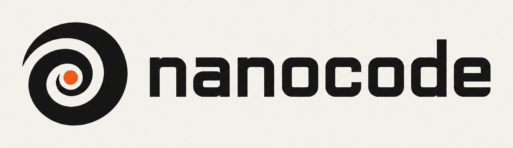

<p align="center">
  
</p>

Welcome to the Nanocode organization.

Nanocode is an SDK for frontier embedded agents, written in Rust. One core runs the same agent,
with the same prompts, durability and Hands, in a terminal, a Cloudflare Worker, a browser tab, a
Vercel Function, a Mac app or an iPhone.

You can install Nanocode on macOS and Linux in seconds via:

```
curl -L https://nanocodex.paradigm.xyz | bash
```

Then, in a new terminal run: `nc`.

That's it! If everything goes well, you will now have a coding agent in your terminal, and the same
agent is ready to embed in your own app:

- [nanocode](https://github.com/gakonst/nanocode): the Rust SDK and the `nc` CLI
- [nanocode-ts](https://github.com/gakonst/nanocode-ts): the SDK as one WebAssembly module, for Workers, Vercel, Node and browsers
- [nanocode-swift](https://github.com/gakonst/nanocode-swift): the SDK for macOS and iOS, with AppKit and UIKit views

Try the live demos:

- [nanocode.xyz/cloudflare](https://nanocode.xyz/cloudflare): durable agents in Cloudflare Durable Objects ([source](https://github.com/gakonst/nanocode-cloudflare-durable))
- [nanocode.xyz/vercel](https://nanocode.xyz/vercel): durable agents on Vercel Workflows, with [ChatGPT-style](https://nanocode.xyz/vercel/chatgpt) and [Claude-style](https://nanocode.xyz/vercel/claude) clones ([source](https://github.com/gakonst/nanocode-vercel-durable))
- [nanocode.xyz/machines](https://nanocode.xyz/machines): an agent in your browser that pays for every token from your Tempo Wallet ([source](https://github.com/gakonst/nanocode-machines-web))

See the [Nanocode Docs](https://nanocode.xyz) for more.

Nanocode development is spearheaded by [Paradigm](https://github.com/paradigmxyz) and the open-source community.
